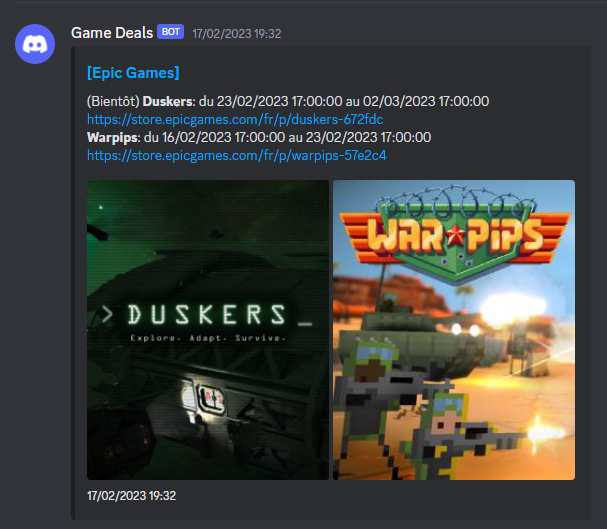

# Epic Games free games tracker

Checks the Epic Games store api and the Steam store for free games and sends a webhook when it finds one

Send a webhook similar to the following:


## Table of contents

- [Table of contents](#table-of-contents)
- [Requirements](#requirements)
- [Usage](#usage)
- [Docker Compose](#docker-compose)
- [Docker Command](#docker-command)
- [Environment](#environment)
- [License](#license)

## Requirements

- node@>=26
- [mise](https://mise.jdx.dev/)

## Usage

First, clone the repo via git and install the tools and dependencies

```bash
git clone https://github.com/KosmoMoustache/epic_games_free_games.git
mise install
pnpm install
```

Then, run the project

```bash
node ./src/index.ts
```

## Docker Compose

```bash
mkdir epic-games-free-games
cd epic-games-free-games
curl -o compose.yml https://raw.githubusercontent.com/KosmoMoustache/epic_games_free_games/main/compose.yml
docker compose up -d
```

Set `EGFG_SCHEDULE`, `WEBHOOK_URL` and `LOCALES` in [`compose.yml`](./compose.yml) before starting. `EGFG_SCHEDULE` accepts a standard cron expression (for example `0 17 * * *`); the container stays running and executes the script on that schedule. See the [Environment](#environment) section for more information.

```bash
docker compose logs -f
docker compose down
```

The container runs as the non-root user `node`. On startup it takes ownership of `/app/db` and `/app/logs`, so bind mounts work regardless of the host directories' original owner.

## Docker Command

```bash
docker run -d \
  --name epic-games-free-games \
  --restart unless-stopped \
  -e EGFG_SCHEDULE="0 */6 * * *" \
  -e EGFG_RUN_ON_START="true" \
  -e WEBHOOK_URL="https://discord.com/api/webhooks/CHANGE_ME" \
  -v db:/app/db \
  -v logs:/app/logs \
  ghcr.io/kosmomoustache/epic_games_free_games:latest
```

## Environment

| Key         | Default          | Description                                                                                                                                                             |
| ----------- | ---------------- | ----------------------------------------------------------------------------------------------------------------------------------------------------------------------- |
| WEBHOOK_URL | REQUIRED         | The webhook url                                                                                                                                                         |
| UPTIME_URL  | none (optional)  | The URL to monitor the application's uptime.used.                                                                                                                       |
| LOG_LEVEL   | info             | The log level. Accept `debug`, `info`, `warn` and `error`.                                                                                                              |
| USE_CACHE   | false            | If the application should use a file (./freeGamesPromotions.json) as the api instead of calling epic games' server. Should only be used when testing and/or developing  |
| LOCALES     | en-GB            | The BCP 47 locale used to format dates (e.g. `fr-FR`).                                                                                                                  |
| EGFG_SCHEDULE | REQUIRED (Docker) | Cron schedule used by the Docker entrypoint (e.g. `0 */6 * * *`).                                                                                                      |
| EGFG_RUN_ON_START | true | Run an initial check when the container starts, before waiting for the cron schedule.                                                                                  |

## License

[GNU General Public License v3.0 © (gpl-3.0)](https://github.com/KosmoMoustache/epic_games_free_games/blob/main/LICENSE)
